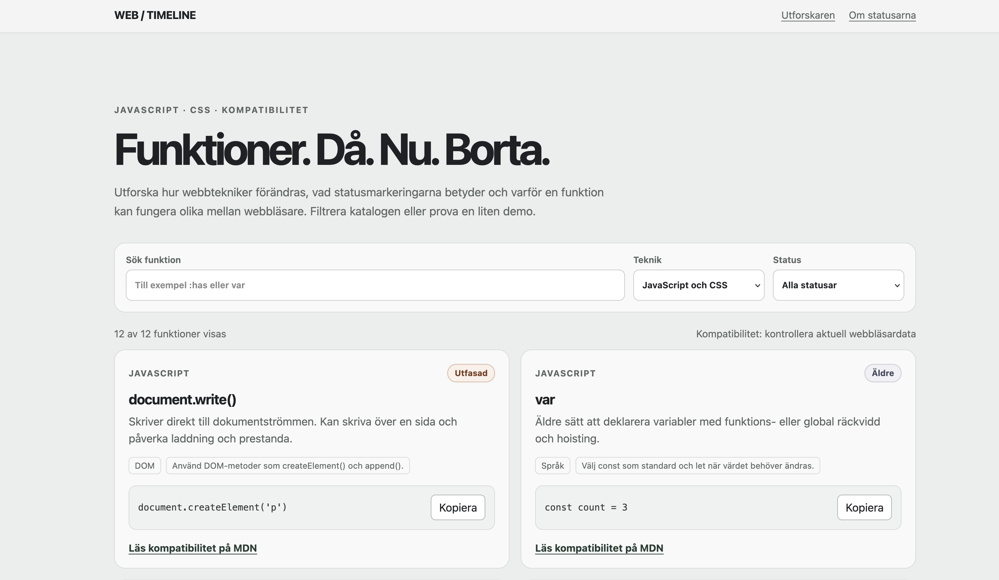
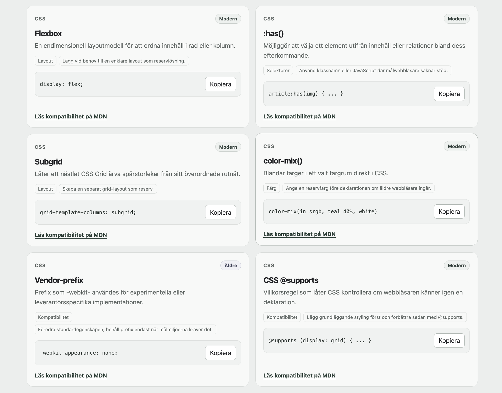
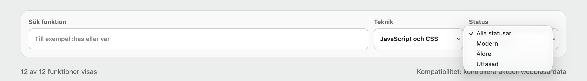
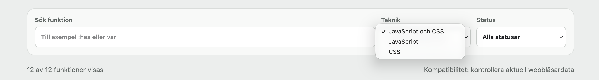
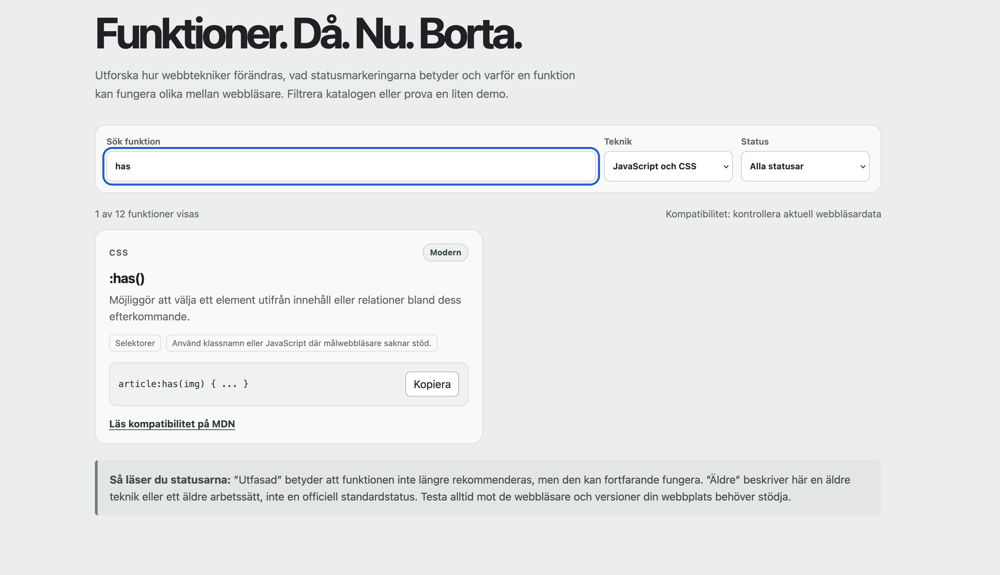
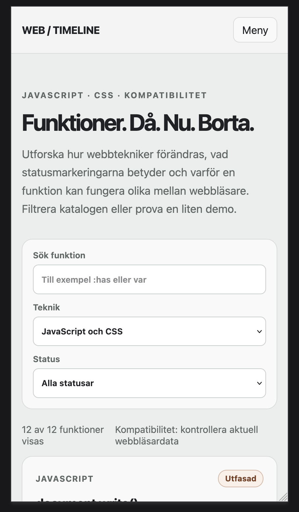

# Browser API för CSS och JavaScript
Sök efter funktioner som finns, utfasade (deprecated) m.m. samt filter för JS och CSS: Utöka vid behov då detta är avsett för intern dokumentation och / eller tetst av ny personal.

